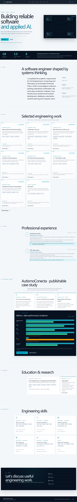

# Sebastián Astroza — Engineering Portfolio

Evidence-led, bilingual portfolio for software engineering, applied machine learning, infrastructure and research-oriented roles.

The site is intentionally explicit about evidence boundaries: synthetic datasets are labelled, CPU-only benchmarks are not presented as GPU results, academic prototypes are not presented as production deployments, and no CERN affiliation is implied.

## Preview



The mobile project catalogue capture is available at [`docs/screenshots/projects-mobile.png`](docs/screenshots/projects-mobile.png). The bounded AutismoConecta case study is documented in both [desktop](docs/screenshots/autismoconecta-case-study-desktop.png) and [mobile](docs/screenshots/autismoconecta-case-study-mobile.png) captures.

## Stack

- React 19, TypeScript and Vite
- Tailwind CSS 4 plus a small custom design system
- Lucide icons
- Vitest and React Testing Library
- Playwright
- GitHub Actions and GitHub Pages

## Local development

Requires Node.js 20 or newer.

```bash
npm ci
npm run dev
```

Open `http://localhost:5173/`.

## Validation

```bash
npm run lint
npm run typecheck
npm test
npm run build
npx playwright install chromium
npm run e2e
```

## Content maintenance

Project content is typed and versioned in `src/data/projects.ts`. See [MAINTENANCE.md](MAINTENANCE.md) before adding or changing claims, [PROJECT_EVIDENCE.md](PROJECT_EVIDENCE.md) for the evidence map, and [PROFESSIONAL_EVIDENCE_PUBLIC.md](PROFESSIONAL_EVIDENCE_PUBLIC.md) for the public authorship boundary.

CV files are deliberately absent until their current PDFs are provided and verified. The UI disables those downloads rather than exposing broken links. See [DEPLOYMENT.md](DEPLOYMENT.md).

## Documentation

- [Architecture](ARCHITECTURE.md)
- [Content sources](CONTENT_SOURCES.md)
- [Project evidence](PROJECT_EVIDENCE.md)
- [Professional evidence boundary](PROFESSIONAL_EVIDENCE_PUBLIC.md)
- [Deployment](DEPLOYMENT.md)
- [Maintenance](MAINTENANCE.md)
- [Privacy](PRIVACY.md)
- [Validation record](VALIDATION.md)

## License

No reuse license has been selected. Copyright remains with Sebastián Andrés Astroza Aguayo unless a license is added explicitly.
