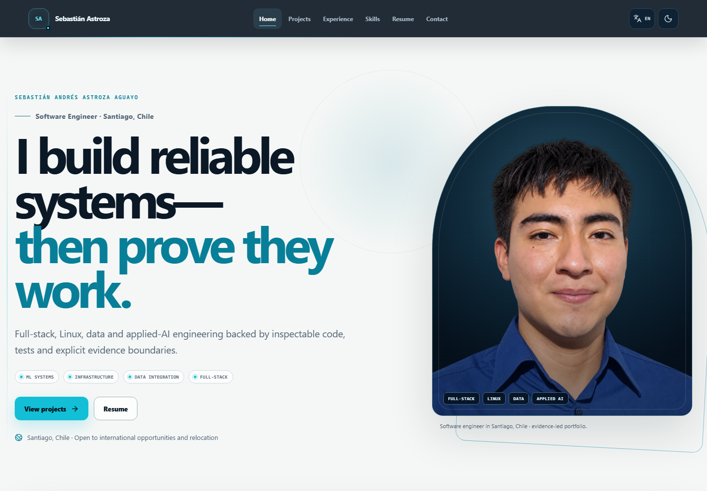

# Sebastián Astroza — Engineering Portfolio

Evidence-led, bilingual portfolio for software engineering, full-stack, infrastructure, data, automation, applied machine learning and research-oriented roles.

The site is intentionally explicit about evidence boundaries: synthetic datasets are labelled, CPU-only benchmarks are not presented as GPU results, academic prototypes are not presented as production deployments, and no CERN affiliation is implied.

## Preview



The UX/UI V2 release is captured across the full 320–1920 px test matrix, including compact desktop, tablet, mobile and landscape orientations. Focused evidence shows the [900 px navigation](docs/screenshots/v2-after/navigation-compressed-900.png), [mobile navigation panel](docs/screenshots/v2-after/navigation-mobile-open-390.png), [tablet About layout](docs/screenshots/v2-after/about-tablet-820.png), [mobile About layout](docs/screenshots/v2-after/about-mobile-390.png), [desktop featured projects](docs/screenshots/v2-after/featured-desktop-1440.png) and [tablet featured projects](docs/screenshots/v2-after/featured-tablet-820.png). A reproducible [navigation-transition video](docs/evidence/navigation-transitions-v2.webm) covers Home → Projects → Resume → Contact.

Motion V3 adds one coherent animation system: staged hero entry, explicit route exit/entry phases, component-specific scroll reveals, animated evidence bars, filter-result choreography and a measured active-navigation indicator. The repository preserves paired [before](docs/evidence/motion-v3/before/) and [after](docs/evidence/motion-v3/after/) desktop/mobile recordings plus route-transition frames. The [motion audit](docs/MOTION_V3_AUDIT.md) and [five-run Lighthouse comparison](reports/motion-v3/lighthouse-summary.json) document the implementation and its performance boundary.

The three reported V2 defects remain under [`docs/screenshots/v2-before/`](docs/screenshots/v2-before/) for direct before/after comparison; earlier release captures remain under [`docs/screenshots/before/`](docs/screenshots/before/). The transparent portrait is also inspected on [white, black, gray and production-gradient backgrounds](docs/screenshots/portrait-background-check.png).

## Stack

- React 19, TypeScript and Vite
- Tailwind CSS 4 build pipeline plus a tokenized editorial CSS design system
- Lucide icons
- Vitest and React Testing Library
- Playwright
- GitHub Actions and GitHub Pages

## Local development

Requires Node.js 20 or newer.

```bash
npm ci
npm run dev
```

Open `http://localhost:5173/`.

## Validation

```bash
npm run lint
npm run typecheck
npm test
npm run build
npx playwright install chromium
npm run e2e
```

## Content maintenance

Project content is typed and versioned in `src/data/projects.ts`. See [MAINTENANCE.md](MAINTENANCE.md) before adding or changing claims, [PROJECT_EVIDENCE.md](PROJECT_EVIDENCE.md) for the evidence map, and [PROFESSIONAL_EVIDENCE_PUBLIC.md](PROFESSIONAL_EVIDENCE_PUBLIC.md) for the public authorship boundary.

The resume page publishes general English and Spanish CVs as PDF-only downloads. Editable DOCX files are intermediate local build artifacts under the ignored `tmp/` directory and are never published. The PDFs are visually inspected, checked for selectable text and clickable links, and validated by `scripts/validate_resume_artifacts.py`. The public portrait uses transparent desktop and mobile WebP variants; the original source image remains excluded from Git.

## Documentation

- [Architecture](ARCHITECTURE.md)
- [Content sources](CONTENT_SOURCES.md)
- [Project evidence](PROJECT_EVIDENCE.md)
- [Professional evidence boundary](PROFESSIONAL_EVIDENCE_PUBLIC.md)
- [Deployment](DEPLOYMENT.md)
- [Maintenance](MAINTENANCE.md)
- [Privacy](PRIVACY.md)
- [Validation record](VALIDATION.md)
- [Motion V3 audit](docs/MOTION_V3_AUDIT.md)

## License

No reuse license has been selected. Copyright remains with Sebastián Andrés Astroza Aguayo unless a license is added explicitly.
